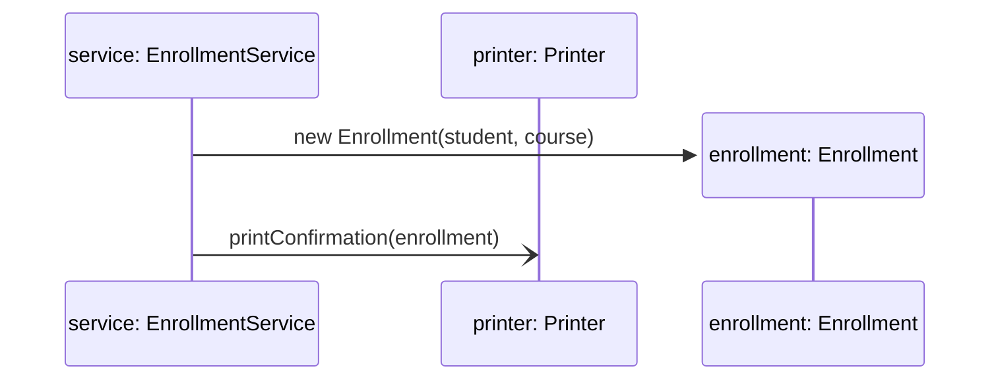
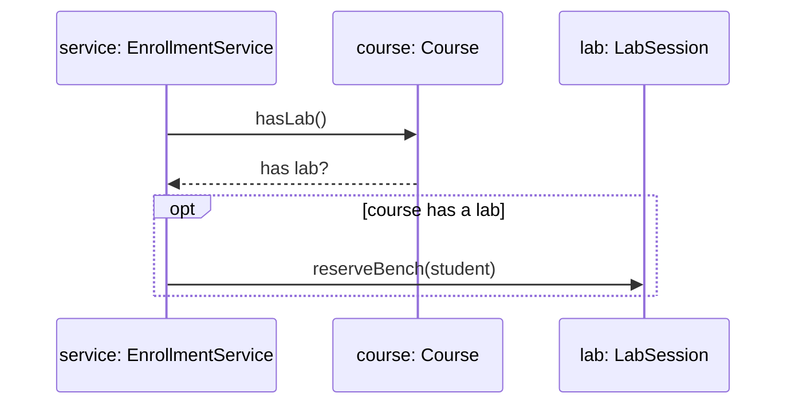
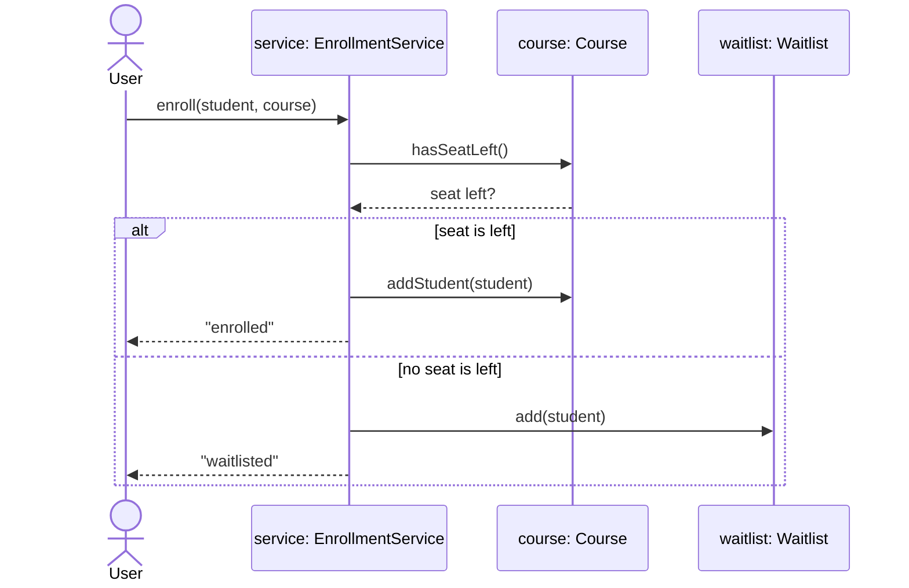
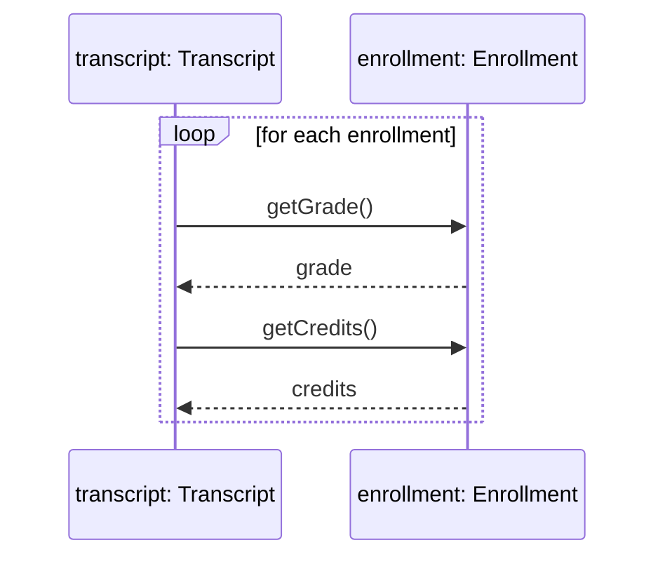
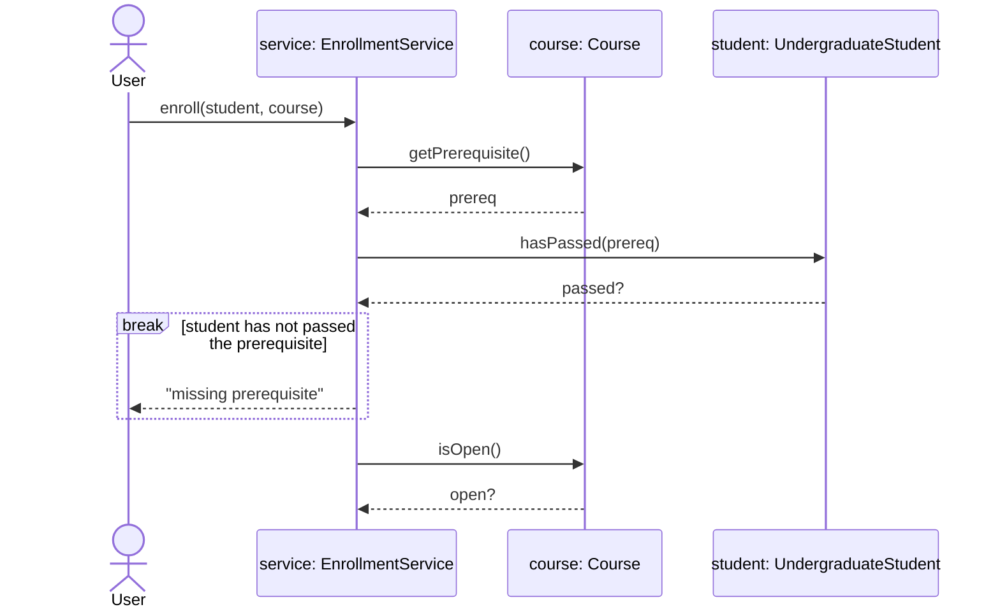
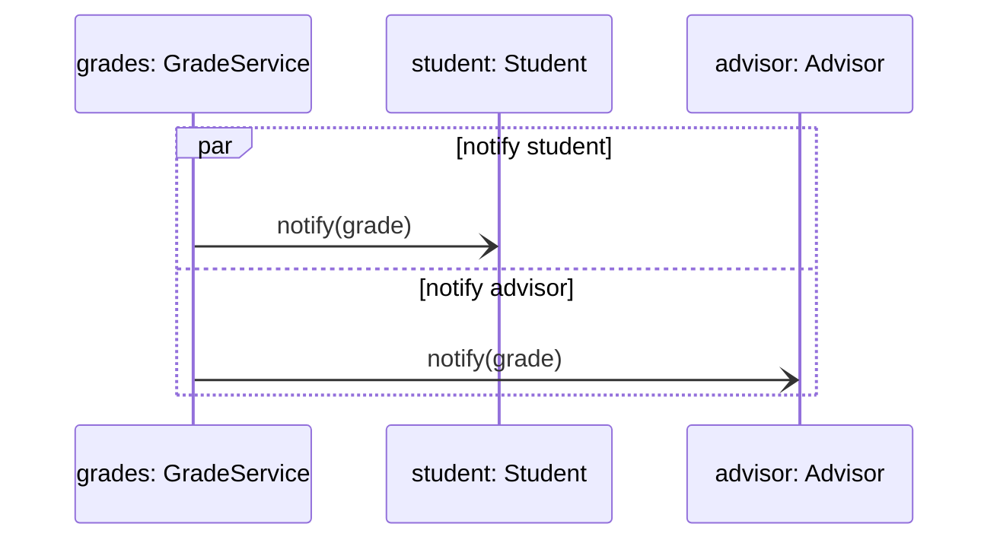
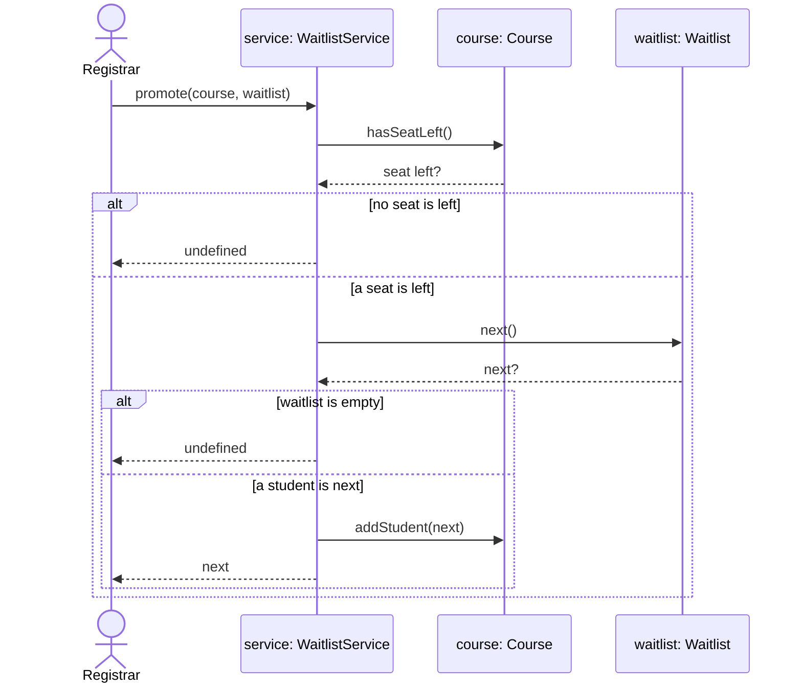
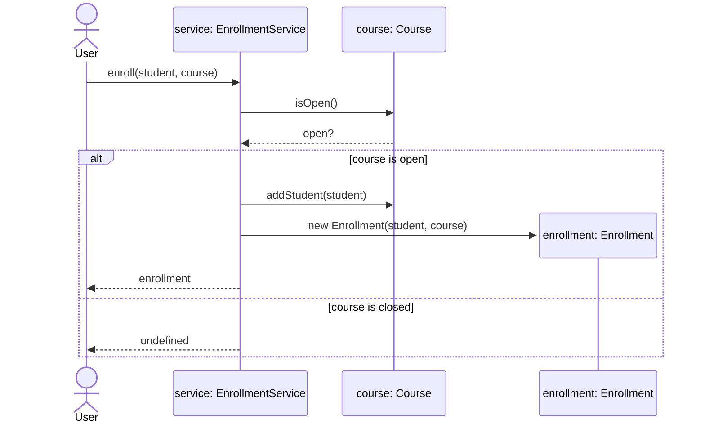

# Lab 6 — Answers

## Exercise 1

- (a) Messages **3** and **5** are returns.
- (b) `Course` must have `removeStudent(student)` (message **2**) and `getCredits()` (message **4**). `UndergraduateStudent` must have `removeCredits(6)` (message **6**).
- (c) As drawn, the service still gets the course's credits and removes 6 credits from the student, even though the student was not enrolled. Add an `alt` fragment after message 3: put messages **4–6** in the `[student was enrolled]` branch and leave the `[student was not enrolled]` branch empty.

## Exercise 2



- (a) The enrollment box starts lower because the enrollment object is created during the interaction.
- (b) Message 2 is an asynchronous message, drawn with a solid line and an open arrowhead.

## Exercise 3



## Exercise 4



## Exercise 5



## Exercise 6



## Exercise 7



## Exercise 8

| Sentence from the requirements | Fragment |
|---|---|
| "For each course in the student's list, …" | `loop` |
| "If the student asked for a printed timetable, also print it." | `opt` |
| "The student pays the fees either by card or by bank transfer." | `alt` |
| "If registration is closed, refuse and stop." | `break` |
| "Email the student and the advisor at the same time." | `par` |

## Exercise 9



## Exercise 10

```typescript
enrollAll(student: Student, courses: Course[]): number {
  let accepted = 0;
  for (const course of courses) {
    if (course.isOpen()) {
      const credits = course.getCredits();
      if (student.addCredits(credits)) {
        accepted++;
      }
    }
  }
  return accepted;
}
```

## Exercise 11

| # | Line of the diagram | What is wrong | Correction |
|---|---|---|---|
| 1 | `S->>E: new Enrollment(student, course)` | The enrollment is created before checking whether the course is open, so the closed-course path would create one too. | Move the creation into the open-course branch, after checking `isOpen()`. |
| 2 | `C->>S: true` | A return is drawn as a call from the course, and `true` does not express either possible result. | Use the return arrow `C-->>S: open?`. |
| 3 | `S->>C: seats = seats - 1` | The service directly changes the course's internal state instead of asking the course to add the student. | Use `S->>C: addStudent(student)`. |


